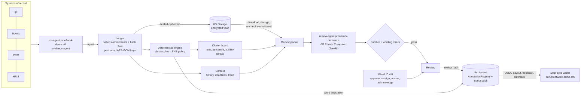

# Proofwork - verified KRAs, fair bonus reviews

> **Agents collect. Code computes. Humans decide. Chain proves.**

Year-end appraisals run on memory and spreadsheets, so every bonus review ends with "you never looked at my work". Proofwork plugs into the systems a company already uses (git, tickets, CRM, HRIS) and turns the work itself into a bonus decision nobody can dispute:

1. **An AI agent collects evidence** from the systems of record. Every item gets a salted commitment and joins a hash chain. It is encrypted under its own key and replicated to **0G Storage**.
2. **A deterministic engine (no LLM)** scores each person against their **peer cluster's** KRA plan. Clusters are department × level (Software IC, Software Senior, Account Executive, Marketing Executive, Product Manager), and people are only ever compared inside their own cluster.
3. **A three-layer review** shows HR:
   - Layer 1: the score inside the cluster.
   - Layer 2: context from past periods (trend, deadlines, targets).
   - Layer 3: reasoning written inside **0G Private Computer** from the encrypted vault. Every number and every above/below claim in the text is checked against the data.
4. **Humans decide with World ID**:
   - The client co-signs a claim.
   - The manager approves a scorecard.
   - HR signs off before a review goes on chain.
   - The employee confirms they received their review.

   Each proof is bound to the exact hash being decided and works once.
5. **The chain proves it.** Evidence roots, score attestations and review hashes are anchored on **Arc testnet**. Bonuses are paid in USDC from a vault with a holdback, disputes, and a clawback when evidence is reverted.
6. **ENS is the company directory** (`proofwork-demo.eth`): departments, clusters (each publishing its KRA plan hash), AI agents (with model and prompt hash), chain signers, contracts on Arc (ENSIP-11), and every employee.

## Architecture



## Live on testnets

| Sponsor | What runs live | Proof |
|---|---|---|
| **Arc** | `AttestationRegistry` `0x9ab5E0cc44b7336DE8306c9f2F91d7cC832d5112`, `BonusVault` `0x3FE940C4F1464d769795d24157037BEf7C3ec97F` (USDC). The backend's role keys anchor evidence batches, attest scores, register plans, release payouts with a holdback, and apply revisions (clawback). Review hashes are anchored as batch ids ≥ 1e9. Testnet amounts are scaled 1:10,000 (CR-003), and the UI says so. | e.g. score attestation `0x2332fba0…27cd`, payout `0x87a814b6…f968`, review anchor `0xcfe4d837…85f4` on explorer.testnet.arc.io |
| **0G** | **Private Computer**: AI claim drafting and the review reasoning (`0gm-1.0-35b-a3b`, TeeML), with provider, request id and `ZG-Res-Key` recorded. **Storage**: every evidence payload is uploaded as ciphertext, downloaded back and compared byte for byte; reviews read the vault and recompute every commitment. | review page → "Why this review can't be disputed" |
| **World** | World ID 4.0 (IDKit 4.6) with RP-signed requests (signed on the web server; the key never reaches the browser). Four actions, each bound to the hash being decided, with nullifiers consumed so a proof works once: `pw-approve-scorecard`, `pw-cosign-claim`, `pw-anchor-review`, `pw-ack-review`. | approval, co-sign, review anchor, review acknowledgement |
| **World ID Agent Pass** | Human checkpoint for the headless 0G review agent (auth.world.org OIDC device flow). The agent cannot read the vault until an **Orb-verified human** approves that exact request; the backend validates the ID token (RS256/JWKS, iss, aud, `acr`, fresh `auth_time`), requires the World ID `(iss, sub)` linked to that HR persona, and uses each approval **once, for one operation, within 10 minutes**. 10 denied paths tested. Debrief: [`docs/WORLD-AGENT-PASS.md`](docs/WORLD-AGENT-PASS.md) | cluster board → Prepare review → QR → review page "Agent authorization" |
| **ENS** | ENSv2 on Sepolia: `proofwork-demo.eth` with its own registry and PermissionedResolver. Five departments, five clusters (`policy` = plan formula hash, checked live on the cluster board), two agents (`review-agent` publishes the hash of its system prompt, checked live on every review), chain signers, Arc contracts via ENSIP-11 coin type `0x80000000 \| 5042002`, and 30 people. The web shows a name only when it forward-resolves to that exact address. | `/org/directory` resolves all of it live |
| **ENS access control** | Granular, hierarchical write roles enforced by ENSv2 contracts, not by our backend. One **PermissionedResolver per department** (plus one per agent), deployed with the VerifiableFactory. EAC roles: the org admin holds everything; **HR** has SET_TEXT + SET_ADDRESS on every department and REGISTRAR/UNREGISTER/RENEW on the subname registry (hire, offboard); each **department manager** gets `grantSetterRoles(setText(*, key))` for `title`, `cluster`, `status` only, on their own department only; employees write nothing. Aliases via `linkToNode` (`head.software` → `elena`, `hrbp.people` → `jon`). | `/org/access`: 13 allow/deny cases simulated live on Sepolia, plus a real edit signed with the persona's key (Elena edits Ben ✓, Ben edits Chen ✗ reverted by the resolver). Script: `contracts/scripts/ens-roles.mjs`, addresses in `deployments/ens-roles.json` |
| **ENS review credentials** | When HR anchors a review on Arc, the backend **issuer** key (REGISTRAR + RENEW only) registers `r-<hash8>.proofwork-demo.eth` to the employee's wallet: **expires in one year**, `roleBitmap 0` so the holder can **neither transfer nor delete** it, records `review_hash`, `anchor_tx`, `anchor_chain`, `employee`, `issued_by`. Only HR (UNREGISTER) can **revoke** it. The **review agent signs its own `prompt` record** with its own key at boot whenever the running prompt changes (it caught and fixed a stale hash on its first run). | review page → "Review credential on ENS": e.g. `r-8691f383.proofwork-demo.eth` (Ben), owner, on-chain expiry and HR revoke, all live. Backfill: `scripts/issue-credentials.ts` |
| **0G agents with real tool calling** | The evidence agent (`kra-agent`) plans its own work on **0G Private Computer with OpenAI-style function calling**: 0G picks which connectors to call (git, tickets, crm, hris, worklog), code executes each call, and the run records every 0G `call_…` id and request id. The model never sees or writes evidence values; a coverage guard (code) runs any connector it skipped, labelled as such. | run trace: `0G tool call call_9d15…` per tool, e.g. `run_133bb9f4aadfb8dade69` |
| **Zero-knowledge** | An employee proves "my score is at least X" without revealing it. HR/manager commits `Poseidon(score, salt, keccak(scorecard_id) >> 8)` and anchors it on Arc (batch ids ≥ 2e9). Only the employee can fetch the witness; the Groth16 proof (circom, `packages/zk/circuits/score_threshold.circom`) is generated in their browser in about 0.5 s. Anyone verifies a share link three ways: locally (snarkjs), on Arc via `ScoreThresholdVerifier` `0x1907a282369b7CeE9cf169F43d222d6d13F46728`, and against the anchored root. A forged threshold is rejected. Proofs can be **recorded permanently on Arc** in `ScoreProofRegistry` `0x5ab3EFC23aC16cF22475EAd577888375aE21aE66`, which re-runs the verifier and the anchored-commitment check on chain before storing them; the API relays the tx (no gas for the employee). | scorecard → "Zero-knowledge proof" → `/prove` → `/prove/verify#…` |

## The three-layer review (CR-004)
- **Layer 1, KRA score in the cluster.** Same engine, same plan for every member; integer statistics (median, quartiles, σ, percentile, z); a board hash anyone can recompute. Comparing across clusters returns `409 cluster_mismatch`.
- **Layer 2, context.** One HRIS performance review per past period plus the ticket system's deadline record. These enter as ordinary evidence (committed, encrypted, on 0G) and never change a score. Code computes the trend, average, volatility, target-hit rate and on-time rate. Fixed rules raise signals: improving, declining, deadline risk, above/below cluster, and so on.
- **Layer 3, reasoning.**
  - The packet is built only from vault payloads whose commitments re-verify, plus layers 1 and 2. Values are pre-formatted, and above/below is given explicitly, so the model never calculates.
  - 0G writes the HR text: strengths, concerns, a same-cluster peer comparison, bonus position, promotion readiness, talking points and citations.
  - Every number in the text must appear in the packet, and no sentence may contradict an above/below field. Otherwise the answer is rejected; after one retry, a labelled deterministic writer takes over.
  - review hash = keccak(canonicalJson({packet_hash, context_hash, inputs_hash, output_hash})). HR anchors it on Arc (World step-up), and the employee acknowledges it (World ID).

## Run it
```bash
pnpm install
pnpm spec:check                               # spec, fixtures, two-language vectors, ABIs, generated types
pnpm --filter @proofwork/api test             # 123 API tests
pnpm --filter @proofwork/api start            # API on :8787 (apps/api/.env)
pnpm --filter @proofwork/web dev              # web on :3000 (apps/web/.env.local)
```
- Everything external sits behind an adapter: `CHAIN_MODE`, `WORLD_MODE` and `ZEROG_MODE` are `mock` or `live`, and the UI labels each one.
- Live needs these in `apps/api/.env`:
  - Arc role keys
  - World `WORLD_APP_ID` / `WORLD_RP_ID`
  - 0G `ZEROG_API_KEY`, `ZEROG_MODEL`, `ZEROG_STORAGE_*`, `ZEROG_PRIVATE_KEY`
  - `ENS_NETWORK=sepolia`, `ENS_PARENT_NAME`
- Live also needs `WORLD_RP_ID` and `WORLD_RP_SIGNING_KEY` in `apps/web/.env.local`.
- `/demo` loads the organisation:
  - `s1`: baseline evidence
  - `s5`: the five clusters with three past periods and deadlines
- Scripts:
  - `contracts/scripts/ens-org.mjs` writes the ENS namespace.
  - `apps/api/scripts/replicate-0g.ts` moves existing evidence to 0G Storage.

## Honest limits
- 0G's router does not return a TEE verdict, so the review shows the provider address, request id, `ZG-Res-Key` and the sealed (E2EE) status instead of claiming "TEE verified".
- The number and wording checks catch invented numbers and contradicted comparisons. They cannot judge tone or emphasis. HR reads the text before anchoring it, which is why anchoring needs a human (World ID).
- Hashes prove *what was committed*, not that the source system was truthful. That is why system-of-record connectors, client co-signatures and reverts exist.
- Peer and history data are a simulated organisation (26 people in 5 clusters, 3 past periods). Every value still flows through the same ledger, 0G vault, engine and chain as live data.
- "Designed for erasure via crypto-shredding" is not a claim of GDPR/DPDP compliance. DORA metrics are team context, weighted accordingly.

- The ZK trusted setup is single-party (powers of tau 2^12 plus one phase-2 contribution, run locally by `packages/zk/build.mjs`). Production needs a multi-party ceremony. The proof shows the score is at least X for a commitment the company anchored; it does not show the score itself was fair (that is what the evidence ledger and attestation are for).
- Persona keys for the ENS edit demo are deterministic demo keys funded with Sepolia ETH only.

## Repository
`spec/` (OpenAPI 1.4.0, fixtures, vectors, Solidity interfaces) · `apps/api` (Fastify, SQLite, engine, ledger, 0G, World, chain, reviews) · `apps/web` (Next.js 15) · `apps/ingest` (GitHub webhook + Telegram bot) · `contracts/` (Arc contracts, deploy and ENS scripts) · `CHANGE_REQUESTS.md` (CR-001 … CR-004).
