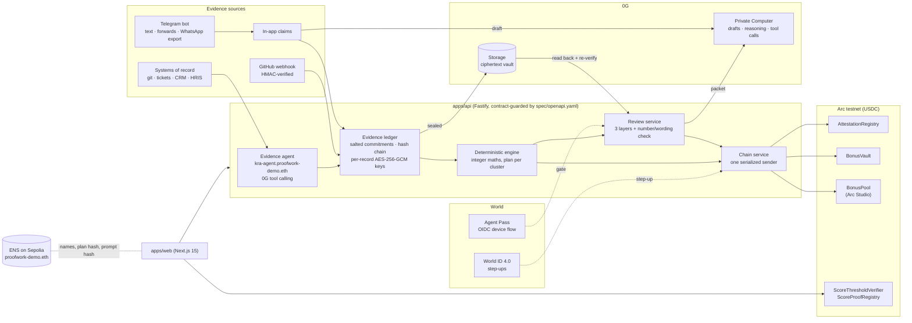
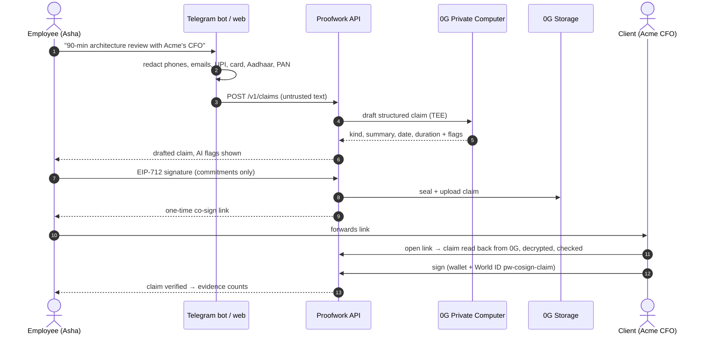
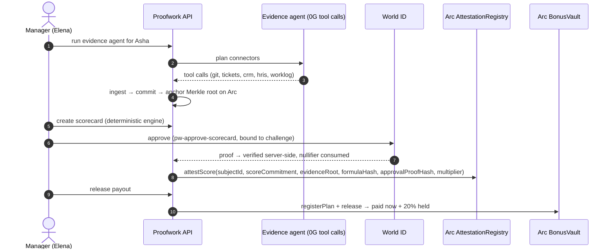
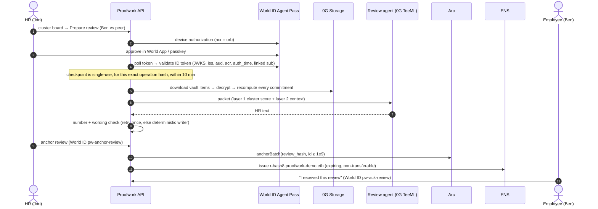
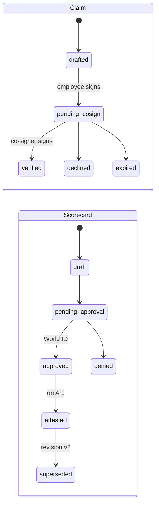
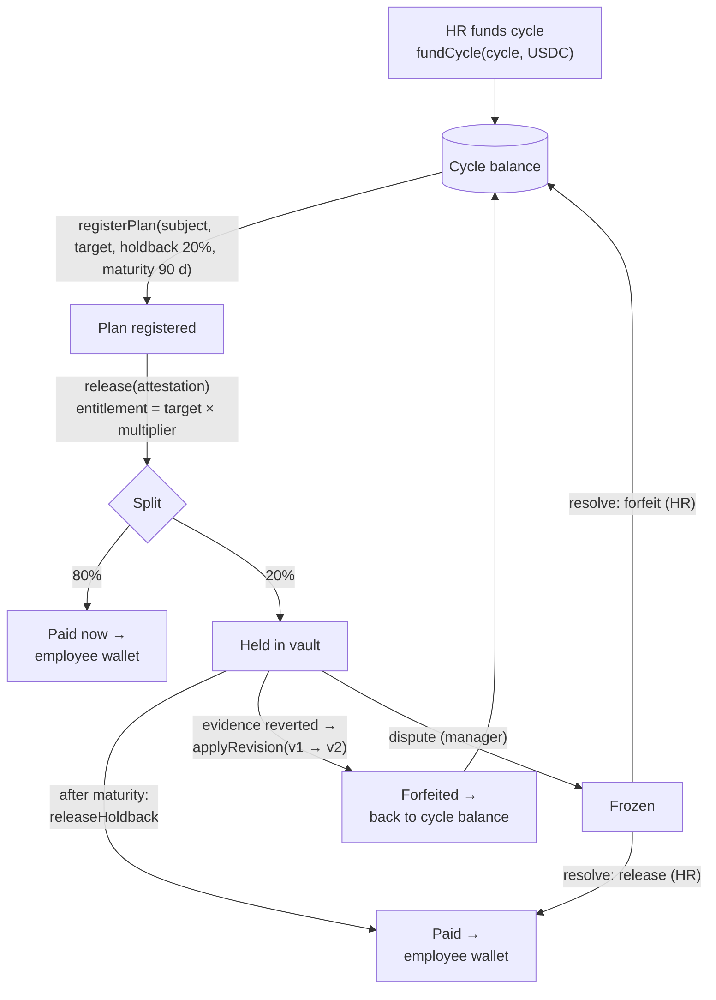
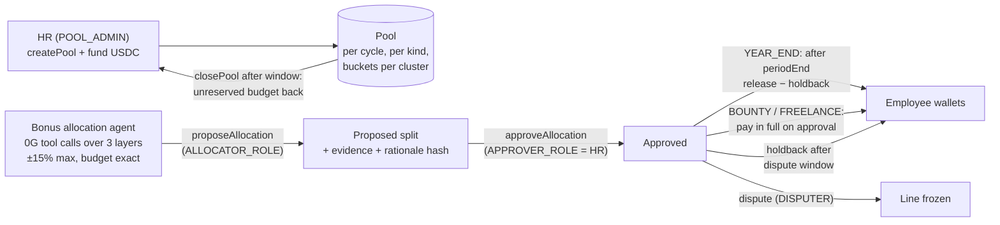
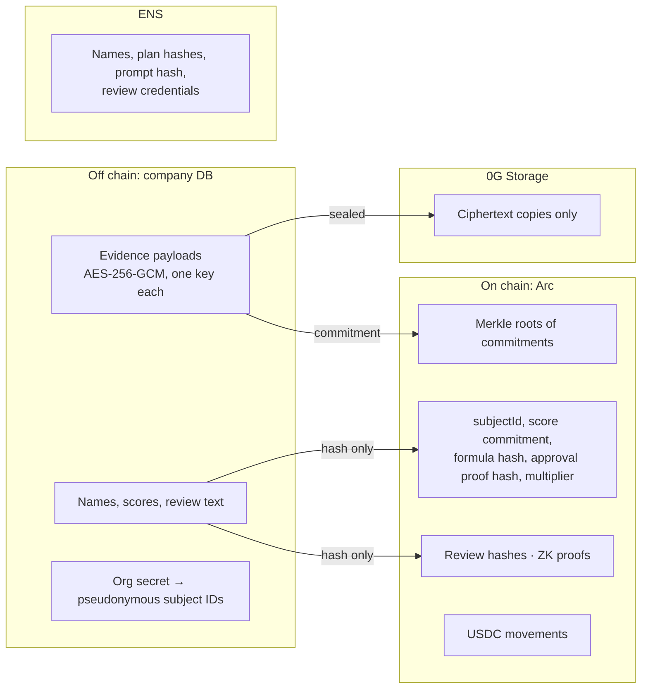

# Proofwork: architecture, flows and stack

Companion to [PROJECT_OVERVIEW.md](PROJECT_OVERVIEW.md). Every diagram is Mermaid and renders on GitHub.

## 1. System architecture



**Rules the architecture enforces:**
- **One frozen contract.** `spec/openapi.yaml` is the single contract between backend and frontend. The API refuses to register a route that isn't in it, and validates every request and response against it.
- **One chain sender.** Only the backend sends transactions, through one lock, using two role keys: anchor/attest, and payout.
- **No AI in the arithmetic.** Models draft, plan and explain. Code computes, checks and decides what is allowed.
- **Mock or live per service.** Every external service sits behind an adapter set by `CHAIN_MODE`, `WORLD_MODE` or `ZEROG_MODE` (`mock` | `live`), and the UI labels each one.

## 2. User flows

### 2.1 Informal work becomes counted evidence (employee → client)



### 2.2 Score → approval → chain → payout (manager)



### 2.3 The three-layer review, with Agent Pass (HR → employee)



### 2.4 Lifecycles



## 3. How the money flows

### 3.1 Per-employee bonus: `BonusVault`



- **Worked example, from the seed scenario:**
  1. Asha's 5,000 USDC target × a 1.00 multiplier = 5,000 entitlement, so 4,000 is paid at once and 1,000 is held.
  2. A merged PR is later reverted. The engine flags the scorecard; v2 scores 8621 bps, with a multiplier of 0.9052.
  3. The new entitlement is 4,526, so the vault **forfeits 474 USDC** back to the cycle, and 526 stays held.
- **On testnet** the vault moves 1/10,000 of these amounts (`CHAIN_AMOUNT_DIVISOR`). The API always reports full scale, and the UI labels the scale.

### 3.2 Team and bounty pools: `BonusPool`, built in Arc Studio



**Who can move money:**

| Actor | Can | Cannot |
|---|---|---|
| AI agent | Propose an allocation | Approve it or move any funds |
| HR | Approve, resolve disputes, fund and close pools | Change an attested score |
| Manager | Release, dispute | Approve their own scorecard |
| Employee | Receive, prove score with ZK | Edit evidence, scores or reviews |
| Backend | Send transactions through one lock, with two role keys | Act without the step-up the action requires |

## 4. What lives where (privacy)



- **On chain:** no names and no raw scores. Subject IDs are `keccak(orgSecret, employee, cycle)`, so each person gets a fresh pseudonym every cycle.
- **Shredding** deletes a record's key. The ciphertext becomes unreadable everywhere, including 0G, while `verify` still proves the record existed.
- **ZK:** an employee proves `score ≥ X` for the commitment HR anchored, using Groth16 in the browser (about 0.5 s). It is verified locally, by the Arc verifier contract, and against the anchored root.

## 5. Why this exact stack

| Choice | Why this and not the obvious alternative |
|---|---|
| **TypeScript monorepo + frozen OpenAPI spec** | Two agents built backend and frontend in parallel. A frozen spec, generated types and a contract guard (unknown routes and fields are refused) meant no integration drift. Changes went through recorded change requests (CR-001 … CR-006). |
| **Fastify** | Schema-first and fast. It fits request and response validation against the spec, with idempotency keys and per-route rate limits. |
| **SQLite (WAL, STRICT tables)** | One portable file, deterministic, and zero ops for a demo that has to run anywhere. The ledger and audit log are hash-chained, so tampering is detectable regardless of the database. |
| **Integer-only engine + two-language vectors** | Money and scores must reproduce exactly. A Python generator and a JS reference engine produce the same vectors as the production port, so floats can never drift. |
| **Envelope encryption (AES-256-GCM, a key per record)** | Makes crypto-shredding real: deleting one key erases one person's record everywhere, including in 0G replicas. |
| **viem + EIP-712** | Typed signatures for claims and co-signs, the same library on server and browser, and a precise contract ABI. |
| **Arc** | USDC is the gas token and the payout asset, so payroll maths, fees and settlement are all in dollars. Arc Studio and Circle wallets build and deploy the pool contract. |
| **0G Private Computer** | HR evidence is too sensitive for an ordinary hosted LLM. TEE inference, plus OpenAI-compatible tool calling, lets the agents plan without ever seeing values they shouldn't. |
| **0G Storage** | A tamper-evident, independent copy of every encrypted record. The review agent reads from it and re-verifies each commitment, so the AI provably used the committed data. |
| **World ID 4.0 + Agent Pass** | Uniqueness without identity, and per-action nullifiers for one-time approvals. Agent Pass puts a verified human between an autonomous agent and the most sensitive read in the product. |
| **ENSv2** | A public, verifiable company directory. Clusters publish their plan hash and agents their prompt hash, so the UI can show "✓ matches ENS". Role-scoped resolvers enforce who may edit what, on chain. |
| **circom + Groth16 (snarkjs)** | Small proofs generated in the browser and verified cheaply on Arc. Employees can share "≥ X" without revealing their score. |
| **Next.js 15 + React 19 + IDKit 4.6** | Server routes keep the World RP signing key off the browser, while one app serves employees, managers, HR, the co-sign page and public verify. |
| **grammY + GitHub webhooks** (`apps/ingest`) | Meet work where it happens: chats and PRs. Redaction runs in the bot, before anything leaves it. |

## 6. Trust boundaries and checks

| Threat | Defence |
|---|---|
| AI invents a number or comparison | Packet-only facts, a number and wording check, one retry, then a labelled deterministic writer |
| Prompt injection in a claim | Text treated as data, `prompt_injection_suspected` flag shown to the co-signer, and the AI can't set the state, KRA, amount or addresses |
| A bot approves, or a proof is replayed | World ID bound to action + hash, with a nullifier per (action, object). Agent Pass requires Orb level, a fresh `auth_time`, a linked `sub`, single use, and expires after 10 minutes. |
| Edited history | Hash-chained ledger and audit log, Merkle roots on Arc, and a public `verify` |
| Double-spend or races | One chain lock in the API, idempotency keys per action, conditional state transitions |
| Data exposure | Encryption per record, ciphertext-only replicas, pseudonymous on-chain IDs, and in-bot redaction |

## 7. Repository map

```
spec/            OpenAPI (1.6.0), fixtures, two-language vectors, Solidity interfaces, reference engine
apps/api         Fastify API: ledger, engine, claims, reviews, agents, World, 0G, chain, ENS
apps/web         Next.js 15 app: employee, manager, HR, co-sign, verify, org directory, ZK prove/verify
apps/ingest      Telegram bot + GitHub webhook / backfill
contracts/       AttestationRegistry, BonusVault, ScoreThresholdVerifier, ScoreProofRegistry; ENS scripts
packages/        crypto (the only hashing implementation), shared (generated types), zk (circuit)
```
