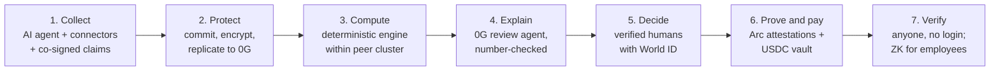
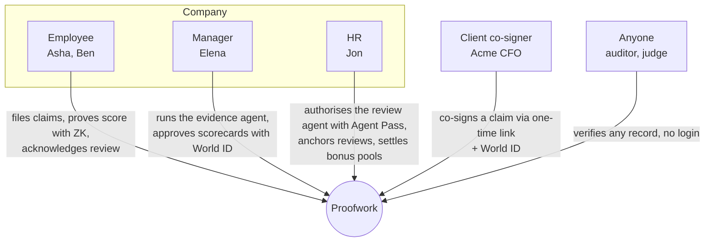

# Proofwork: project overview

> **Agents collect. Code computes. Humans decide. Chain proves.**

**One line:** Proofwork turns the work people actually did into a bonus decision that anyone can check and nobody can quietly change.

**In a paragraph:**
- Proofwork connects to the systems a company already runs (git, tickets, CRM, HR) and to the places informal work happens (client chats, WhatsApp, Telegram).
- An AI agent gathers the evidence. Every item is committed, encrypted and replicated to 0G Storage.
- A deterministic engine, with no AI in the arithmetic, scores each person only against peers in the same role and level.
- A 0G review agent writes the explanation HR gives the employee. Every number in it is checked against the data.
- Every decision is made by a verified human with World ID:
  - the client confirms a claim
  - the manager approves a score
  - HR authorises the AI and signs off the review
  - the employee acknowledges it
- Scores, review hashes and USDC bonus payouts, with holdbacks, disputes and clawbacks, are recorded on Arc.
- ENS is the company's public directory: who works where, which plan applies, which agent wrote what.
- A zero-knowledge proof lets an employee show "my score is at least X" without revealing it.

---

## 1. The problem

Every year-end review ends in the same argument: *"You never looked at my work."* It persists because each step of today's process can be disputed and none of it can be checked.

| Step today | What goes wrong | Who loses |
|---|---|---|
| **Evidence** lives in memory, spreadsheets and chats | Informal work (a client call that saved a deal, a 2 a.m. incident fix) is invisible. Recency bias wins. | Employees whose work isn't in a dashboard |
| **The score** is computed by hand or in a black-box tool | Nobody can reproduce the number, so nobody can contest it with facts | Everyone: trust drops, attrition rises |
| **Comparison** mixes levels and roles | A junior engineer is ranked against a senior, or sales against engineering | Juniors, minority roles |
| **AI is arriving in HR** | An LLM summary can invent a number or a comparison, and the employee can't see what it was based on | Employees, and the company's legal position |
| **The payout** is a payroll line | Bonuses get changed after the fact, clawbacks are arbitrary, disputes have no trail | Employees and finance |
| **Privacy** | Performance data is among the most sensitive data a company holds, and deleting it properly is hard | Employees |

**Why now:**
- AI agents are starting to do HR work: collecting evidence, drafting reviews, proposing bonus splits.
- Employment decisions are a high-risk use of AI under emerging regulation such as the EU AI Act.
- Agents need a **human checkpoint they cannot skip**, and their output needs a **record nobody can alter**. Proofwork provides both.

## 2. What Proofwork does

| Promise | How it is kept |
|---|---|
| **Every piece of work counts, but only if it is real** | Systems of record (git, tickets, CRM, HR) count immediately. Informal claims count only after the client or manager co-signs with a wallet or World ID. Reverted work is removed automatically. |
| **The score is reproducible** | A published formula (its hash is on ENS and in every attestation), integer arithmetic, and test vectors in two languages. Anyone can recompute it. |
| **Fair comparison** | People are compared only inside their **peer cluster** (department × level). Cross-cluster comparison is refused (`409 cluster_mismatch`). |
| **AI that cannot make things up** | The AI drafts claims and writes review text, but it never sets a number. Every number and every above/below statement in its text must exist in the data packet, or the text is rejected and a deterministic writer takes over. |
| **Humans decide, provably** | Four World ID step-ups (approve, co-sign, anchor, acknowledge), each bound to the exact hash being decided and usable once. A fifth checkpoint, World ID Agent Pass: the review agent cannot even read the vault until a verified human approves that specific run. |
| **Money moves by rule** | USDC on Arc: release with a 20% holdback, clawback when evidence is reverted, a dispute freeze that HR resolves. An AI agent can *propose* a bonus-pool split; only HR can approve it. |
| **Privacy by design** | Only hashes, pseudonymous IDs and multipliers go on chain. Records are encrypted with their own keys, and deleting a key erases the record (crypto-shredding). An employee can prove "score ≥ X" with zero knowledge. |

## 3. Who uses it

## 4. Sponsor integrations

| Sponsor | Why it is essential, not decorative | What runs live |
|---|---|---|
| **Arc** | Bonuses are dollars, so settlement must be in dollars. Arc's USDC-native gas and USDC payouts keep payroll maths in one currency, with predictable fees. | `AttestationRegistry` (evidence roots, score attestations, review anchors), `BonusVault` (release, holdback, clawback, dispute), `ScoreThresholdVerifier` + `ScoreProofRegistry` (ZK), and **BonusPool built in Arc Studio** (agent proposes, HR approves, USDC released) |
| **0G** | HR data is too sensitive for an ordinary hosted LLM, and must survive the company's own database. | **Private Computer**: claim drafting, review reasoning, and an evidence agent that plans its own tool calls. **Storage**: every evidence payload as ciphertext, read back and checked before the AI uses it. |
| **World** | Every consequential step needs a real, unique human, and every AI agent needs a human checkpoint. | World ID 4.0: approve scorecard, co-sign claim, anchor review, acknowledge review. **Agent Pass** (OIDC device flow, Orb-level) before the review agent runs. |
| **ENS** | A company needs a public, verifiable directory of people, plans, agents and contracts. | ENSv2 `proofwork-demo.eth`: departments, clusters with their plan hash, agents with their prompt hash, contracts via ENSIP-11, 30 people, role-based write permissions, and expiring, non-transferable **review credentials** |

## 5. What makes it different

1. **The AI is fenced in.** It collects, drafts and explains, but code computes every number, and the review text is checked against the data before anyone sees it.
2. **Every human decision is cryptographically bound** to the exact hash it approves, so an approval can't be reused or swapped.
3. **Money follows the evidence.** If a merged PR is reverted, the score is flagged, revised to v2, and the vault takes back the difference on chain.
4. **Verification is public; data is not.** Anyone can check a record against the chain, and nothing private is revealed.

## 6. Status (Sat 7 Nov 2026)

- **Live on testnets:**
  - Arc: chain 5042002, with vault amounts scaled 1:10,000 for testnet funding; the UI says so
  - 0G Private Computer and Storage
  - World ID 4.0 and Agent Pass
  - ENS (ENSv2 on Sepolia)
  - ZK proofs verified on Arc
- **Simulated:** the organisation (26 people in 5 clusters, 3 past periods). Every value still flows through the real ledger, vault, engine and chain.
- **Known limits:**
  - 0G's router does not report a TEE verdict, so we show the provider, request ID and `ZG-Res-Key` instead of claiming "verified".
  - The ZK trusted setup is single-party.
  - Crypto-shredding is a design property, not a compliance claim.

See [ARCHITECTURE.md](ARCHITECTURE.md) for the technical flows, the money flows and the reasoning behind the stack.
